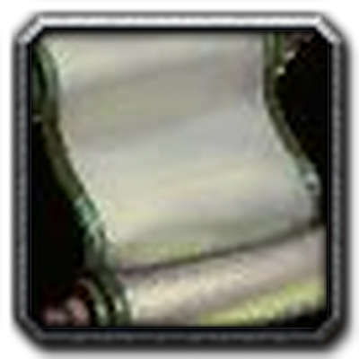
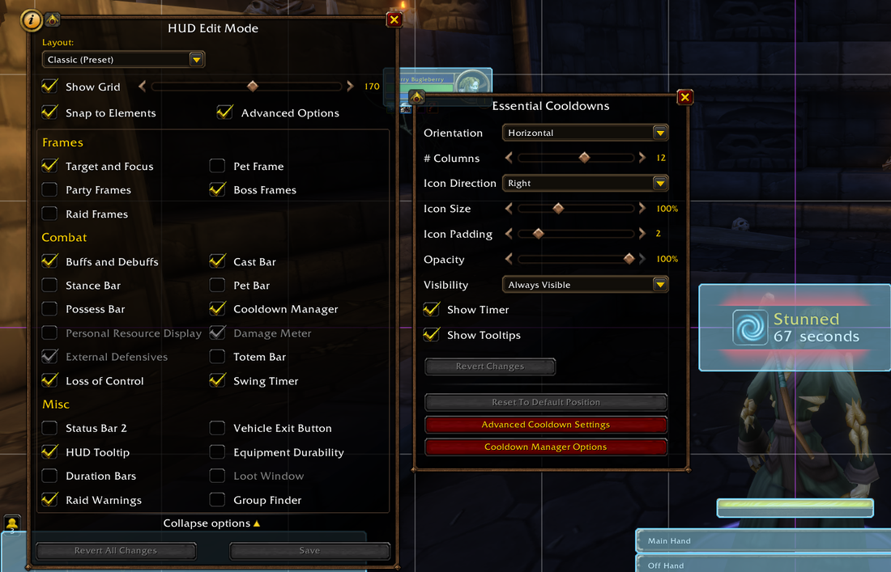
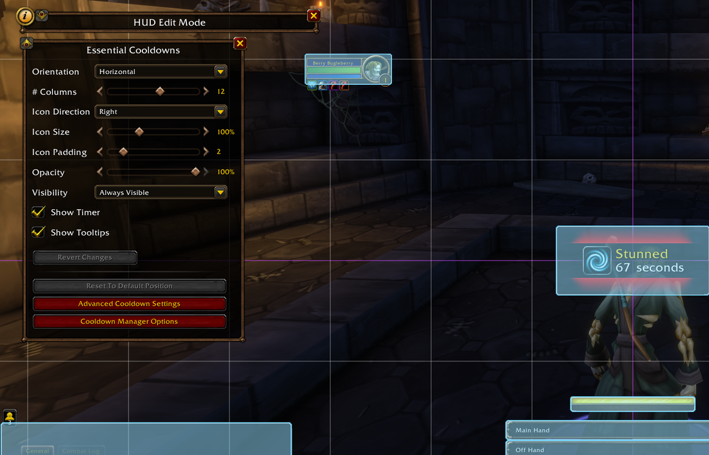

<h1> Edit Mode Window Shading</h1>

I made this because Edit Mode's settings windows kept covering the frames I was trying to move.

Made for WoW: Forever and only ever tested there. It may or may not work on Retail or Classic.

| Open | Rolled up |
| --- | --- |
|  |  |

- Double-click a window's title, or click the arrow in its top-left corner, to roll it up to just
  the title row. Do it again to open it.
- Drag a window (or its rolled-up bar) anywhere and it stays there, even when you select another
  element. Spots are saved per window title.
- Works on Blizzard's Edit Mode windows and on addon ones built the same way, like Cooldown Manager
  Centered's settings window.

## Install

Download the zip from [Releases](../../releases) and copy the `EditModeWindowShading` folder into
`World of Warcraft/_forever_/Interface/AddOns`.

## Commands

| Command | What it does |
| --- | --- |
| `/ws reset` | Clears saved spots and rolled-up windows |
| `/ws debug` | Lists the windows it's tracking |
| `/ws log on` / `/ws log off` | Starts or stops the log |
| `/ws log` | Shows the last 20 log lines in chat |
| `/ws log clear` | Empties the log |

If something acts up, `/ws log on`, do the thing, then `/reload`. The log is in
`WTF/Account/<account>/SavedVariables/EditModeWindowShading.lua`.

## Reporting a bug

Open an issue here (or comment on CurseForge) and copy this in:

```
Subject: Bug: <what went wrong, in a few words>

Addon version:
Game version:
What happened:
What I expected:
Steps:
1.
2.
Error:
Other addons:
```

Then attach the log and a screenshot.

- **Addon version:** in the CurseForge app, or `## Version` in `EditModeWindowShading.toc`
- **Game version:** type `/run print(GetBuildInfo())` in chat and copy what it prints
- **Error:** paste the whole Lua error. If none shows, type `/console scriptErrors 1` and try again
- **Log:** `/ws log clear`, `/ws log on`, make the bug happen, `/reload`, then attach
  `WTF/Account/<account>/SavedVariables/EditModeWindowShading.lua`. `/ws log off` after
- **Other addons:** especially ones with their own Edit Mode windows. Does it still happen with only this one on?
